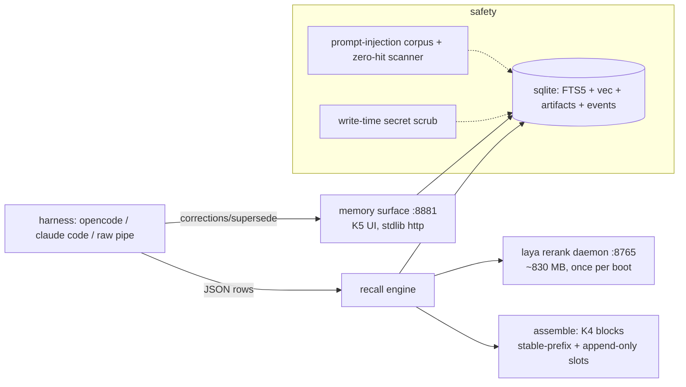

# kodand

**Persistent, explainable memory plane for coding agents.** SQLite-local storage,
session-aware CPU decision-model rerank, write-time lifecycle for updated facts,
artifact-aware provenance, cache-aware context assembly, a visual memory surface
and safety gates in the box. Works finish-offline; pip in 60 seconds; adapter for
any harness that can shell out.


---

## Table of contents

1. [The 60-second quickstart](#quickstart-pip-60-seconds)
2. [What problem this solves](#what-problem-this-solves)
3. [What it does / does NOT do](#what-kodand-does--does-not-do)
4. [Measured results (honest)](#measured-results-honest)
5. [Architecture at a glance](#architecture-at-a-glance)
6. [Adapter for your harness](#adapter-for-your-harness)
7. [Visual memory surface](#visual-interactive-memory-surface)
8. [Safety](#safety-in-the-box)
9. [Documentation set](#documentation-set)
10. [CLI surface](#cli-surface)
11. [Licence](#licence)

## Quickstart (pip, 60 seconds)

```sh
pip install kodand                    # zero-dep core: FTS recall
pip install "kodand[laya]"            # CPU decision-model rerank tier
kodand fetch-model                    # ~644 MB checkpoint, sha-verified -> ~/.kodand/
kodand rerank-serve &                 # scoring daemon, ~830 MB, once per boot
KODAND_LAYA_URL=127.0.0.1:8765 kodand recall --repo . --query "..." --laya-filter --json
```

Every order of operations (plain FTS, retrieval daemon, the rerank tier, the
human surface) works even if one peer is down. Kill switch: `KODAND_BASELINE=1`
reverts to plain FTS for every consumer in one env var.

## What problem this solves

Coding agents are stateless. Every session starts blank, which forces the same
three failure classes to repeat across 100-session histories:

| failure class | where it hit us | what kodand does about it |
|---|---|---|
| evidence found but answers still wrong | session recall >80% while answers lagged | citation contract (per-row sessionId/entryId, conflict resolution-by-date, explicit abstain) |
| newer facts compete with older | knowledge-update regressions at ranking time | write-time `supersede` lifecycle; corrections carry provenance and highest trust |
| real artifacts never become memory | pdf/md/html/code stayed invisible | artifact registry `(uri, sha256)` + provenance prefix in every chunk |
| context churn breaks caches and consistency | 65 s mean search every turn re-shaped context | content-addressed append-only memory blocks with a stable prefix |

## What kodand does / does NOT do

✔ local recall offline (FTS5 BM25 + sqlite-vec, sqlite under the hood)
✔ retrieval ranking is *relative*; each row carries provenance (sessionId /
  entryId / artifact sha) and relationship markers (`session_p`, `superseded_by`)
✔ KNOWING what the agent will read next: the k5 surface shows the exact memory
  block ids and slots that the agent's next prompt uses
✔ secrets blocked on every write path, injection corpus + zero-hit scanner included
✔ every human correction is an on-disk event with `provenance=user` (highest trust)
✖ never sends data anywhere: stores and reads everything locally
✖ never executes recalled text as instructions: returns text, nothing more
✖ never fabricates: every number in this README cites a run report under `bench/reports/`

## Measured results (honest)

LongMemEval-500, identical judge/answering model (nvidia/nemotron-3.5-lightning-30b-a3b):

| config | answer accuracy | evidence recall@10 | note |
|---|---|---|---|
| plain FTS baseline | 270/500 (0.540) | 0.862 | in-repo run report |
| shipped hybrid (BM25 seeds + laya fills) | **284/500 (0.568)** | 0.825 | +14 vs baseline, McNemar p=0.19 (directional, not proven significant) |
| batch: laya addresses the HARD split, cost a recorded -3.7pp evidence coverage on standard text | | | tradeoff documented in DECISIONS D7/D11 |

Per-type wins: temporal 0.496->0.564, knowledge-update 0.756->0.821,
single-session-user 0.743->0.814. Regression class victim: multi-session.
Also verified: 3 different ranking families were measured, killed levers are
registered with numbers (m3 recency 0-w/1-l; budget 8->10 no-op across all).

## Architecture at a glance



Three skill levels of detail:
- [HLD](docs/HLD.md) — components, data flow, trust boundaries, deployment shapes
- [LLD](docs/LLD.md) — module-level detail: schemas, function contracts, JSON shapes, CLI, env vars
- [ARCHITECTURE](docs/ARCHITECTURE.md) — the root-cause narrative, process architecture, cross-cutting invariants, extension protocol, and test architecture
- [DECISIONS](docs/DECISIONS.md) — every decision with its evidence; dead levers recorded with numbers

## Adapter for your harness

Reference adapters in `docs/adapters/` (~60 lines each, with kill switches and
daemon fallbacks): [opencode plugin](docs/adapters/opencode-plugin/),
[Claude Code hooks + MCP](docs/adapters/claude-code-hook/),
[raw pipe](docs/adapters/raw-pipe/). The stdout JSON contract:
best-first array of `{sessionId, entryId, content, ...}` with `session_p` =
relevance provenance when the rerank ran; `KODAND_BASELINE=1` honored by every
consumer (acceptance tested, p95 = 113 ms fallback, 0 laya dials).

## Visual interactive memory surface

```sh
kodand memory-surface --repo ~/work/.kodand/repo-main --port 8881
# open http://127.0.0.1:8881/
```

- memory ledger with state badges (active / superseded with pointer chains)
- inline edit/supersede/correction actions that write REAL events
  (`provenance=user` — highest trust weight)
- artifact panel: file versions (uri@sha) with chunk counts and kind chips
- next-assembly panel: exact memory blocks + slots the agent's next prompt reads
  (K4 blocks in the UI — "explainable by construction")
- browser-verified via headless human-like flows (`tests/verify_k5.py`):
  search, typed correction, save+dismiss, supersede row actions, focus-visible
  keyboard flow (screenshots emitted in the run)

## Safety in the box

- write-time secret scrub (detectors: AWS, github, slack, openai, anthropic,
  PEM, bearer, generic assignment) — blocked before rows appear (`kodand/scope.py`)

- 32-prompt x 4-category forked injection corpus with a zero-hit scanner
  (`bench/safety/scan_artifacts.py`)
- correction provenance = user writes data with more trust than model flows
- kill switch acceptance test: p95 = 113 ms fallback path with zero laya calls

## Documentation set

- README (this) — product view + quickstart
- [HLD](docs/HLD.md) — high-level components, data flows, trust boundaries, topologies
- [LLD](docs/LLD.md) — module-level detail: schemas, function contracts, JSON shapes, env vars
- [ARCHITECTURE](docs/ARCHITECTURE.md) — root-cause narrative, process architecture, invariants, extension protocol
- [DECISIONS](docs/DECISIONS.md) — D1..D30 decisions with evidence and dead-lever records
- [adapter contract](docs/adapter.md) — CLI/daemon/assembly pipes for any harness
- memory surface design ([HTML mock](docs/k5-memory-surface.html))
- benchmark & safety reports: `bench/reports/`, `bench/safety/`

## CLI surface

`kodand init · remember · recall · rerank · rerank-serve · recalld · mcp ·
fetch-model · ingest-artifact · assemble · memory-surface · capture-tick ·
doctor · utility · trust-* · import-jsonl · ...` (see `kodand --help`; LLD §9).

## Licence

Apache-2.0, see [LICENSE](LICENSE). Growth-agents sourced skill text and the
memory surface design mock stay under their own attribution (see
[LICENSES.md](LICENSES.md) in the source [growth-agents][ga] repository).

[ga]: https://github.com/rajat397/growth-agents

## Repo map

```
kodand/  code (store, recall, rerank, artifacts, assemble, surface, cli, mcp, hooks...)
tests/   53 tests incl. G1-G5 browser gates (verify_k5.py, screenshot artifacts)
bench/   safety corpus + scanner, adversarial-30, reports incl. honest negatives
docs/    HLD, LLD, ARCHITECTURE, DECISIONS, adapter contract, surface design
```
