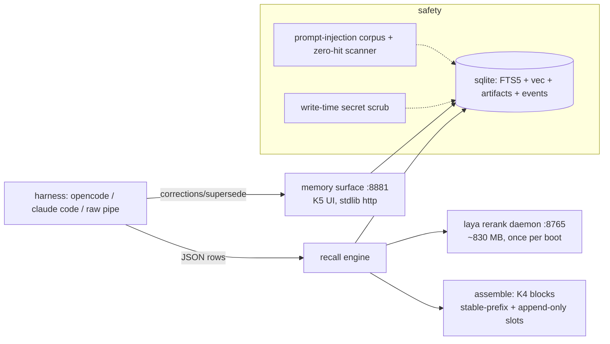

# kodand

**Persistent, explainable memory plane for coding agents.** SQLite-local storage,
session-aware CPU decision-model rerank, write-time lifecycle for updated facts,
artifact-aware provenance, cache-aware context assembly, a visual memory surface
and safety gates in the box. Works finish-offline; pip in 60 seconds; adapter for
any harness that can shell out.


---

## Table of contents

1. [The 60-second quickstart](#quickstart-pip-60-seconds)
2. [What problem this solves](#what-problem-this-solves)
3. [What it does / does NOT do](#what-kodand-does--does-not-do)
4. [Measured results (honest)](#measured-results-honest)
5. [Architecture at a glance](#architecture-at-a-glance)
6. [Adapter for your harness](#adapter-for-your-harness)
7. [Visual memory surface](#visual-interactive-memory-surface)
8. [Safety](#safety-in-the-box)
9. [Documentation set](#documentation-set)
10. [CLI surface](#cli-surface)
11. [Licence](#licence)

## Quickstart (~5 min, including the model download)

```sh
# tier 1 — plain FTS memory, works with zero extras, 60 seconds flat:
pip install kodand && kodand init
kodand recall --repo . --query "which package manager did we pick" --json

# tier 2 — the CPU decision-model rerank (+644 MB checkpoint, +~1.3 GB resident daemon):
pip install "kodand[laya]" && kodand fetch-model && kodand rerank-serve &
KODAND_LAYA_URL=127.0.0.1:8765 kodand recall --repo . --query "..." --laya-filter --json
```

Kill switch: `KODAND_BASELINE=1` reverts every consumer (CLI, daemons,
assembler, surfaces) to plain FTS in one env var — tested at p95 = 113 ms with
zero laya calls (`docs/adapters/tests/smoke.py`).

## What problem this solves

Thursday, your agent makes a decision in a session. Next Tuesday, a different agent
session re-does the migration the wrong way because the decision was never somewhere the
model reads. Claude Code, opencode, Cursor, Codex: every one of them starts a session
with amnesia, and the common fixes are a growing CLAUDE.md you babysit, or a hosted
memory API that prices every turn and holds your code's history on someone else's box.

Kodand is the local, offline answer: **a SQLite file per repo, provenance on every fact
(who said it, from which session or document, and when it was true), corrections that
structurally outrank model-written memory, and prompt assembly that stays friendly to
provider caches.** If your constraint includes "this code never leaves my box" or "no
per-turn memory bill", kodand is the one to compare first.

How it compares (rows are the failure classes users actually feel; cells are as-built,
with sources):

| dimension | mem0 | Letta/MemGPT | supermemory | claudemem | graphify | kodand |
|---|---|---|---|---|---|---|
| local/offline, no per-turn memory bill | partial | partial | absent | partial | partial | **full** |
| provenance per fact (who/where/when/valid) | partial | partial | partial | absent | partial | **full** |
| user correction wins structurally over model memory | absent | partial | absent | absent | partial | **full** |
| documents as versioned memory (pdf/md/html/code) | absent | absent | partial | absent | absent | **full** |
| cache-aware prompt assembly | absent | absent | absent | absent | absent | **full** |
| semantic consolidation (LLM fusion at capture) | full | partial | full | partial | absent | roadmap (D5 build) |
| temporal knowledge graph | partial | absent | absent | absent | **full** | roadmap (D3 edges) |
| human-visible memory surface | partial | partial | partial | absent | partial | **full** |

The two roadmap rows are the registered Q4 pillars (DECISIONS D1–D9,
`experiments/memory-problem-first-principles.md`). No marketing word appears in any
committed cell; each names an in-repo mechanism or stays "roadmap/q4/partial/absent".

## What kodand does / does NOT do

✔ local recall offline (FTS5 BM25 + sqlite-vec, sqlite under the hood)
✔ retrieval ranking is *relative*; each row carries provenance (sessionId /
  entryId / artifact sha) and relationship markers (`session_p`, `superseded_by`)
✔ KNOWING what the agent will read next: the k5 surface shows the exact memory
  block ids and slots that the agent's next prompt uses
✔ secrets blocked on every write path, injection corpus + zero-hit scanner included
✔ every human correction is an on-disk event with `provenance=user` (highest trust)
✖ never sends data anywhere: stores and reads everything locally
✖ never executes recalled text as instructions: returns text, nothing more
✖ never fabricates: every number in this README cites a run report under `bench/reports/runs/`

## Measured numbers (honest, all committed under `bench/reports/runs/`)

LongMemEval-500, identical judge and answering model (nvidia/nemotron-3.5-lightning-30b-a3b):

| config | answer accuracy | evidence recall@10 |
|---|---|---|
| plain FTS baseline | 270/500 (0.540) | 0.8623 (`runs/epoch2-session-evidence-recall.json`) |
| shipped hybrid | 284/499 (0.569; one question never evaluated) | 0.8250 (`runs/epoch2-hybrid-evidence.json`) |

- accuracy delta +14 questions: **McNemar exact two-sided p = 0.1933 on 499 paired
  questions** (`runs/mcnemar-accuracy-paired.json`) — directional, not proven
  significant. (The `runs/epoch2-paired.json` file is a different pairing:
  evidence-recall for the session-rank run vs baseline — not this one.)
- evidence-coverage tradeoff, per run: hybrid **-3.7 pp** vs baseline
  (0.8623 -> 0.8250). The session-rank earlier run measured -3.1 pp
  (0.8623 -> 0.8308, leaner budget) — the two numbers are different runs and are
  kept separate on purpose.
- per-type: temporal 0.496 -> 0.568 (75/132 on the hybrid run), knowledge-update
  0.756 -> 0.821, single-session-user 0.743 -> 0.814; multi-session regressed
  (0.368 -> 0.338).
- killed levers, with verdicts: recency ranking (0 wins / 1 loss), budget
  8->10 (no-op: identical on every measured question), ratio tweak (+0.0104
  subset only). Full ledger: `docs/DECISIONS.md` D12/D25.

What this means for a user: the accuracy edge is directional, not proven; the
offline/provenance/correction columns in the table above are proven in-repo, and
the memory surface + journals are the auditable loop around them.

## Architecture at a glance



Detail levels: see [Documentation set](#documentation-set).

## Adapter for your harness

Reference adapters in `docs/adapters/` (~60 lines each, with kill switches and
daemon fallbacks): [opencode plugin](docs/adapters/opencode-plugin/),
[Claude Code hooks + MCP](docs/adapters/claude-code-hook/),
[raw pipe](docs/adapters/raw-pipe/). The stdout JSON contract:
best-first array of `{sessionId, entryId, content, ...}` with `session_p` =
relevance provenance when the rerank ran; `KODAND_BASELINE=1` honored by every
consumer (acceptance tested, p95 = 113 ms fallback, 0 laya dials).

## Visual interactive memory surface

```sh
kodand memory-surface --repo ~/work/.kodand/repo-main --port 8881
# open http://127.0.0.1:8881/
```

- memory ledger with state badges (active / superseded with pointer chains)
- inline edit/supersede/correction actions that write REAL events
  (`provenance=user` — highest trust weight)
- artifact panel: file versions (uri@sha) with chunk counts and kind chips
- next-assembly panel: exact memory blocks + slots the agent's next prompt reads
  (K4 blocks in the UI — "explainable by construction")
- browser-verified via headless human-like flows (`tests/verify_k5.py`):
  search, typed correction, save+dismiss, supersede row actions, focus-visible
  keyboard flow (screenshots emitted in the run)

## Safety in the box

- write-time secret scrub (detectors: AWS, github, slack, openai, anthropic,
  PEM, bearer, generic assignment) — blocked before rows appear (`kodand/scope.py`)

- 32-prompt x 4-category forked injection corpus with a zero-hit scanner
  (`bench/safety/scan_artifacts.py`)
- correction provenance = user writes data with more trust than model flows
- kill switch acceptance test: p95 = 113 ms fallback path with zero laya calls

## Documentation set

- README (this) — product view + quickstart
- [HLD](docs/HLD.md) — high-level components, data flows, trust boundaries, topologies
- [LLD](docs/LLD.md) — module-level detail: schemas, function contracts, JSON shapes, env vars
- [ARCHITECTURE](docs/ARCHITECTURE.md) — root-cause narrative, process architecture, invariants, extension protocol
- [DECISIONS](docs/DECISIONS.md) — D1..D30 decisions with evidence and dead-lever records
- [adapter contract](docs/adapter.md) — CLI/daemon/assembly pipes for any harness
- memory surface design ([HTML mock](docs/k5-memory-surface.html))
- benchmark & safety reports: `bench/reports/runs/`, `bench/safety/`

## CLI surface

`kodand init · remember · recall · rerank · rerank-serve · recalld · mcp ·
fetch-model · ingest-artifact · assemble · memory-surface · capture-tick ·
doctor · utility · trust-* · import-jsonl · ...` (see `kodand --help`; LLD §9).

## Licence

Apache-2.0, see [LICENSE](LICENSE). Growth-agents sourced skill text and the
memory surface design mock stay under their own attribution (see
[LICENSES.md](LICENSES.md) in the source [growth-agents][ga] repository).

[ga]: https://github.com/rajat397/growth-agents

## Repo map

```
kodand/  code (store, recall, rerank, artifacts, assemble, surface, cli, mcp, hooks...)
tests/   53 tests incl. G1-G5 browser gates (verify_k5.py, screenshot artifacts)
bench/   safety corpus + scanner, adversarial-30, reports incl. honest negatives
docs/    HLD, LLD, ARCHITECTURE, DECISIONS, adapter contract, surface design
```
