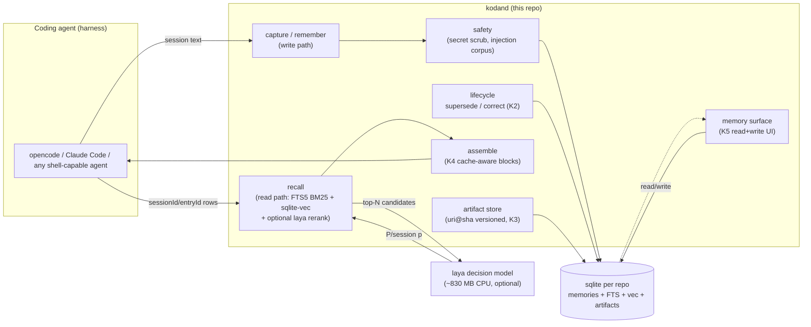
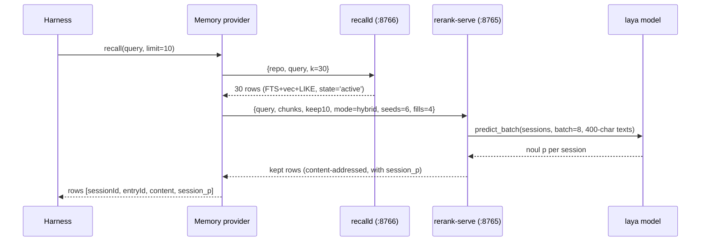
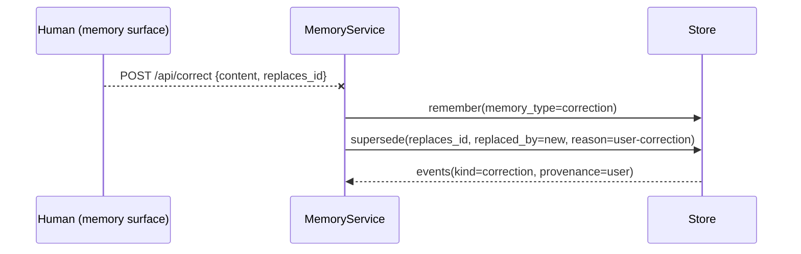

# Kodand — High-Level Design (HLD)

Read this after [README](../README.md) for the 60-second product view, alongside
[DECISIONS.md](DECISIONS.md) for the why behind every choice and
[LLD.md](LLD.md) for code-level detail.

## 1. System context

Kodand is a **local-first memory plane** that coding agents (opencode, Claude Code,
any harness that can shell out) use to *capture*, *recall* and *curate* knowledge
across sessions. It is a separate process surface from the agent itself: agents talk
to it over CLI pipes, TCP daemons, or MCP tools. It never calls the network at
recall time (FTS5/vec sqlite is local), and the optional decision-model tier runs
on CPU (≤ ~830 MB resident) on the same box.

## 2. Architectural principles (observed, enforced)

1. **Local-first, offline recall**: cold start needs zero network; the model fetch
   is an explicitly triggered `kodand fetch-model` with sha256 verification.
2. **Ranking never drops, thresholds never gate**: relative ordering within a
   question carries signal; absolute P thresholds measured worse than baseline
   (0.505-0.458 variance). D5.
3. **Write-time lifecycle over read-time heuristics**: newer facts retire older
   ones via `Store.supersede`/`Store.correct` (D17); recency ranking levers are
   retired with the verdict from experiments.
4. **Provenance is a storage property**: `sessionId + entryId` per row (K1) and
   `artifact:<path>@<sha>` prefixes for artifacts (D19).
5. **Stateless-LLM cooperation**: K4 context assembly hands out content-addressed,
   append-only memory blocks with a byte-stable prefix so provider caches hit
   (D23).
6. **Safety at the write boundary**: keys from known provider shapes blocked
   (scope.py); recalled content is returned as data and never executed (D16);
   injection corpus ships in-repo (D14).
7. **Every lever has a die state**: pre-registered gates in ~/growth (D25) and
   printouts of what got killed, with numbers, survive repositories.

## 3. Components (real code, not aspirational)

| component | module | role |
|---|---|---|
| store + recall | `kodand/store/__init__.py`, `kodand/recall` | sqlite (FTS5 memories table + memories_fts + memories_vec via sqlite-vec) with hybrid fst recall: BM25 + vec semantic + LIKE union; utility-based re-ranking respects original order on ties |
| rerank tier | `kodand/rerank.py` (+ `kodand/fetch_model.py`) | laya session scorer / chunk scorer; `score_sessions`/`rank_sessions`/`hybrid_rank`/serve via TCP to avoid 30 s startup; `fetch-model` downloads + verifies 644 MB checkpoint |
| lifecycle | `kodand/store` ("K2" block) | `supersede`, `correct`, `list_memories_with_supersede_chain` with `superseded_by` pointers and events journal |
| artifact store | `kodand/artifacts.py` | `(uri, sha256)` versioned; content prefix provenance; auto-supersedes older version chunks (K2 integration) |
| block assembler | `kodand/assemble.py` | content-addressed blocks, frozen slot tables (caller-owned state file), byte-stable prefix hash |
| surface | `kodand/surface.py` + `docs/k5-memory-surface.html` | localhost-only store-backed UI (read side + correction/supersede write-backs) |
| daemons & wire | `kodand/rerank.serve_tcp` (:8765), `kodand/recalld.py` (:8766), `kodand/mcp`, `kodand/hooks` | long-lived processes; systemd units in docs/adapters/systemd-units/ |
| adapters | `docs/adapter.md`, `docs/adapters/` | opencode plugin / claude-code hooks / raw pipe reference implementations honoring KODAND_BASELINE |
| safety | `kodand/scope.py`, `bench/safety/` | detector list; injection corpus + zero-hit scanner |

## 4. Data flows (sequence, verified in test suite)

### 4.1 Recal rank (harness query with laya rerank)

### 4.2 Correction loop

## 5. Trust boundaries

| boundary | control |
|---|---|
| secrets enter memory | blocked at `Store.remember` via `scope.check_write` (provider-shaped detectors; anthropic/openai/generic) |
| recalled content is code | never: rows are plain strings; the *agents* interpret them (D16) |
| prompt-injection via memory | 32-row x 4-category corpus + zero-hit scanner for candidate ship states (D14) |
| untrusted fs paths | artifact doc path doubled-encoded in `artifact:` prefix; sha256 identity prevents replay (D18) |
| model download integrity | sha256 verification on sha mismatch `kodand fetch-model` refuses (D2) |
| harness availability | `KODAND_BASELINE=1` reverts whole stack (tests prove p95=113 ms and no laya call) |

## 6. Deployment topologies

| shape | when | pieces |
|---|---|---|
| zero-config | CI cron, quick recall — one-shot CLI | `pip install kodand` |
| daemon-warm | interactive agent sessions | + `recalld`, `rerank-serve` systemd user units |
| full-memory-surface | human-in-loop curation | + `kodand memory-surface --repo ...` |
| distributed (skip) | multiple agent hosts each with their own repo | remote sync explicitly out of scope v0.3.x |

## 7. What LLD covers next

- storage tables, index schemas; code-shaped call sites; JSON examples for the
  surface & CLI APIs; known failure modes and battery measured timings
  (recall 0.08-0.5 s warm; laya load 28-45 s; 4.1 s / 8 states at 160-chars batch;
  hybrid full-500 observational stats search p50 39.8 s / p95 58 s on 2-core;
  suite 53 tests in 20-30 s)
